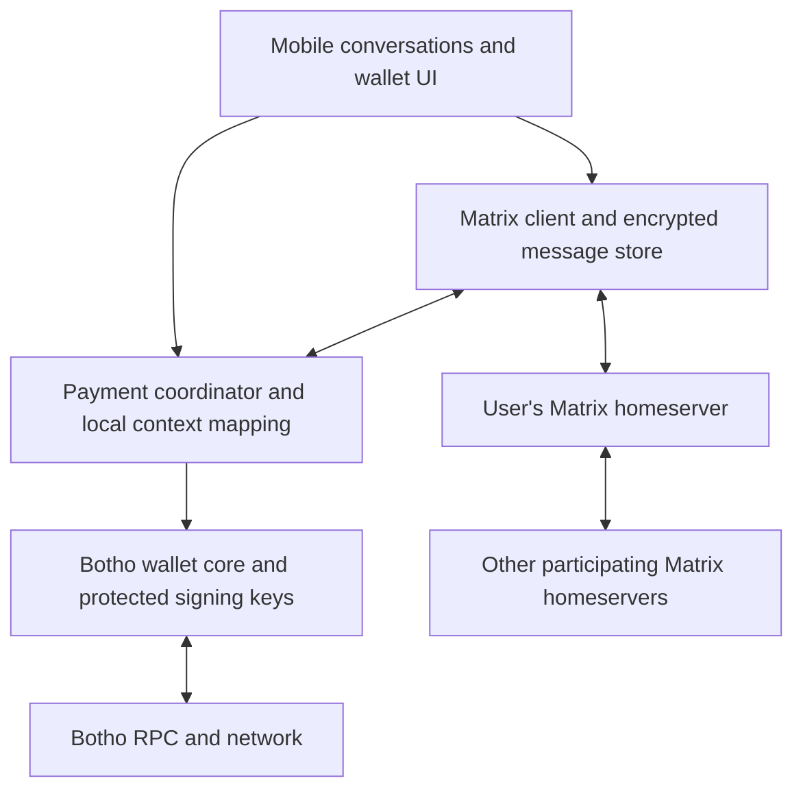

# Mobile Chat & Private Payments with Matrix

**Status**: Proposed — product direction and architecture, not an implemented feature
**Date**: 2026-10-10
**Scope**: Combine Matrix messaging and Botho payments in the mobile client,
while keeping their servers, identities, and signing authority separate.

Related designs: [framework selection](FRAMEWORK_DECISION.md),
[native integration](NATIVE_INTEGRATION.md), and
[wallet backup and recovery](MOBILE_BACKUP_DESIGN.md).

## Product direction

The mobile wallet should let people chat, request money, and pay in one
conversation. The longer-term direction is **private payments in Matrix**:
people can use their existing Matrix account and homeserver, with payment
contexts segmented behind the scenes. They should not need a new public
identity simply to use the wallet.

Matrix provides messaging, account identity, device verification, and federation.
Botho provides wallet operations and payment settlement. The client combines
these APIs into one experience. Matrix access remains optional: people can
create, recover, and use a wallet without a Matrix account.

## Existing foundation and gaps

The mobile architecture already selects React Native / Expo with a Rust wallet
core exposed through UniFFI. The [native integration notes](NATIVE_INTEGRATION.md)
still identify the Expo native module and full device validation as unfinished.
The [wallet wrapper](app/src/native/walletModule.ts) exposes wallet operations;
the [app dependencies](app/package.json) contain no Matrix integration.

The web wallet has [payment-request payloads](../web/packages/core/src/wallet/payment-request.ts)
containing a destination, optional amount, and memo. Their semantics are a useful
starting point, but they do not yet define the authenticated, replay-aware
conversation protocol proposed here. Payment-request links are distinct from
claim links: claim links carry bearer secrets and must not become the default
chat payment mechanism.

Pairwise payment contexts, a durable payment coordinator, Matrix device handling,
and private destination rotation through the mobile API are proposed work.
The [backup design](MOBILE_BACKUP_DESIGN.md) also remains a separate prerequisite
for a complete recovery experience.

## Server and client boundaries

Matrix homeservers federate through Matrix's own protocol; participating
homeservers retain room events according to that protocol. This is independent
of Botho consensus and networking.
See [Matrix rooms and events](https://matrix.org/docs/matrix-concepts/rooms_and_events/)
and the [federation specification](https://spec.matrix.org/latest/server-server-api/).

An operator could offer both services, but they should have separate deployment,
storage, credentials, resource budgets, and failure handling. Chat events do not
belong in blocks, consensus messages, or Botho gossip. A Matrix outage must not
prevent an otherwise available wallet from paying or checking settlement.

The [Matrix Rust SDK](https://github.com/matrix-org/matrix-rust-sdk) is a candidate
for messaging and encryption. Its suitability for this Expo/UniFFI app needs a
native integration spike covering device verification, background sync, storage,
recovery, and battery use. Sharing Rust as an implementation language does not
require sharing wallet and Matrix keys or stores.

## Identity and segmentation

| Layer | Proposed role | Boundary |
|---|---|---|
| Main Matrix account | Familiar login, contacts, and conversations | Does not unlock or recover the wallet |
| Verified conversation | Authenticated channel for requests and destination exchange | Does not itself prove ownership of a payment destination |
| Pairwise payment context | Local mapping of a contact to requests and approved destination bindings | No public Matrix-ID-to-wallet registry |
| Wallet authority | Independently protected keys and explicit spending approval | Matrix credentials and incoming events cannot authorize spending |

For the first version, use verified, end-to-end encrypted one-to-one
conversations under the user's existing Matrix identity. Maintain payment
context mappings in protected local storage. Where Botho and the mobile API
support appropriate destination derivation, scope destinations to a contact or
request; verify those capabilities before promising unlinkability.

Do not place wallet addresses in public profiles, display names, room names,
or unencrypted room state. Carry payment details inside encrypted message
content. Matrix's encryption model uses its own device keys and protocols;
it does not inherit Botho's post-quantum properties.
See [Matrix end-to-end encryption](https://matrix.org/docs/matrix-concepts/end-to-end-encryption/).

Segmentation inside one Matrix account reduces unnecessary wallet linkage, but
separate rooms under the same Matrix ID do **not** hide that identity from
participating homeservers. A later mode could introduce pseudonymous payment
accounts and rooms, with authenticated introductions from the main identity.
That would require a separate provisioning, routing, recovery, and correlation
analysis; IP addresses, timing, shared operators, and account creation can still
connect the identities. It is not an automatic benefit of Matrix federation.

Destination ownership and contact binding need a concrete protocol before
implementation. Explore an in-person QR exchange as an initial trust path, then
define destination authentication, rotation, revocation, and device replacement.
A familiar Matrix name alone is insufficient evidence that a destination is safe.

## Conversation experience

1. **Connect:** sign in to an existing Matrix account, verify the new device,
   and separately create or unlock the Botho wallet.
2. **Request:** choose an amount and optional note in an encrypted conversation.
   The recipient sees a payment card associated with the contact and request.
3. **Review:** tapping Pay opens wallet confirmation showing the amount, fee,
   network, destination, and contact-verification state. Receiving or opening a
   request never submits a transaction.
4. **Approve:** the wallet obtains explicit user approval and submits the payment.
5. **Track:** show submission and confirmation status based on wallet/network
   verification. A chat receipt is a notification, not proof of settlement.

Chat availability, wallet lock state, and payment status should remain visibly
distinct. If payment succeeds while Matrix is unavailable, show the successful
payment and a pending receipt notification. Retrying that notification must not
send money again. An unfamiliar or changed destination needs renewed review.
Use generic push-notification previews by default to avoid exposing payment
details through lock screens or notification providers.

## Payment protocol and durable state

Define a versioned application event carried inside Matrix encrypted message
content. Custom event naming and encryption envelopes must follow the
[Matrix client-server specification](https://spec.matrix.org/latest/client-server-api/).
This is a proposal, not an existing interoperable Matrix payment standard.

The application payload should include a unique request ID, Botho network
identity, destination, optional amount in integer base units encoded as a decimal
string, expiry, and optional memo. Bind requests to the authenticated sender and
conversation; define canonical encoding, bounds, and validation before use.
Never include seeds, private keys, login tokens, or claim-link secrets.

Keep an encrypted durable journal linking each request to its local payment
intent, approval, transaction identity, verification state, and receipt-delivery
state. Persist enough information before submission to recover an ambiguous
result after a timeout or crash. Treat these as separate state dimensions:

| State dimension | Example progression |
|---|---|
| Request | Received → validated → accepted, declined, or expired |
| Payment | Draft → approved → submitting → pending → confirmed |
| Ambiguous submission | Outcome unknown → reconcile with wallet/network before allowing another attempt |
| Receipt delivery | Unsent → queued → delivered, independently of payment confirmation |

Deduplicate repeated events and taps. A Matrix transaction ID can help with
message submission; it cannot guarantee exactly-once payment execution. Do not
automatically create a new spend when submission might already have succeeded.
Requests that expire or are redacted after broadcast cannot undo that broadcast.
Handle chain reorganization and stale RPC responses according to the wallet's
confirmation policy; specify that policy before labeling a payment confirmed.

Multiple logged-in devices need an explicit spending-coordination design. Start
with one payment-authorizing device per wallet until durable cross-device
coordination and recovery are established. A second chat device must not
independently pay the same request. Even within one device, detect duplicate
requests and require deliberate review for any additional payment.

Send only the minimum receipt data needed by the counterparty. The recipient
must verify incoming value through their wallet; a sender-supplied transaction
identifier or “paid” event alone is insufficient. The exact receipt format and
any proof mechanism remain open work.

## Privacy and recovery limits

“Private payments in Matrix” is a product goal with several separate guarantees:

- **Message content:** E2EE protects content from intermediaries under Matrix's
  security model. Counterparties and compromised endpoints can still disclose it.
- **Social metadata:** participating homeservers still observe room membership
  and delivery metadata. E2EE is not social-graph anonymity.
- **Payment privacy:** protection depends on Botho's implemented transaction and
  network properties. [Amounts are public on the current testnet](../docs/concepts/transactions.md);
  encrypted chat does not make them confidential on chain.
- **Correlation:** shared IP addresses, payment timing, RPC queries, reused
  destinations, logs, analytics, and notification systems can connect activity.
  Pairwise contexts alone do not solve these leaks.

Keep wallet secrets independent of Matrix login and device-encryption secrets.
A Matrix account reset must not grant access to funds. Recovery must explain
four separate outcomes: Matrix account access, historical message decryption,
wallet funds, and local contact/payment mappings. Restoring one does not imply
restoring the others. In particular, missing payment-journal history must trigger
reconciliation before an old request can be paid again.

Extend the existing [wallet recovery design](MOBILE_BACKUP_DESIGN.md) with these
boundaries; do not place wallet recovery secrets in ordinary Matrix history or
silently make the homeserver a wallet custodian.

## First implementation slice

1. Complete the native wallet bridge and device validation; spike Matrix SDK
   integration without changing the existing wallet authority model.
2. Demonstrate existing-account login, device verification, and encrypted
   one-to-one chat between accounts on two independent homeservers.
3. Specify and review destination binding, request validation, payment journaling,
   and the initial single-authorizing-device policy.
4. Demonstrate request → explicit approval → independently verified receipt
   between two mobile devices on Botho testnet. Preserve wallet-only operation.
5. Exercise duplicate events, repeated taps, restart during submission, offline
   receipt delivery, expired requests, changed destinations, forged receipts,
   device replacement, and recovery with incomplete history. Measure sync cost,
   RPC load, battery use, and what each server/operator can observe.

Keep pseudonymous Matrix accounts, group payments, merchant workflows, and
cross-device spending out of this first slice. They require additional protocol
and privacy decisions, not just more UI screens.

## Open decisions

- Which Matrix SDK/native bridge meets mobile lifecycle and recovery needs?
- Which Botho receiving primitives support pairwise/request-scoped destinations,
  and what mobile APIs are missing?
- How do verified contacts authenticate destination ownership and changes?
- What confirmation and receipt rules can both wallets independently verify?
- How are the payment journal and contact bindings backed up without linking
  social identity to the entire wallet history?
- What privacy claim is justified against counterparties, homeservers, RPC
  operators, and observers before a public release?
